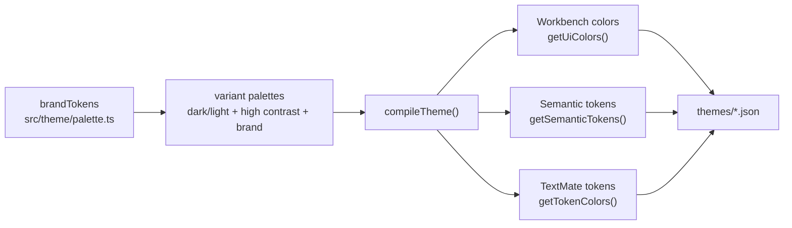

# Contributing

Thanks for contributing to `claude-code-theme`.

## Development Setup

This project uses Node 20+ and pnpm.

```bash
pnpm install --frozen-lockfile
pnpm check
```

## Repository Standards

Changes should follow the same discipline used by official OpenAI and Anthropic OSS repositories:

- clear, scoped pull requests
- reproducible local validation commands
- issue templates for bugs and feature requests
- CI-backed build and quality checks

## Change Guidelines

1. Keep changes role-first.
   - Adjust token intent before adding narrow scope overrides.
2. Preserve accessibility.
   - Run `pnpm contrast` for any color/palette changes.
3. Keep variant behavior consistent.
   - Dark/light/high-contrast should remain semantically aligned.
4. Update docs with behavior changes.
   - Especially `README.md` and `docs/brand-tokens.md`.
5. Use Conventional Commits.

Examples:

- `feat(theme): improve markdown token hierarchy`
- `fix(a11y): increase contrast for light theme strings`
- `docs(readme): clarify installation and activation`

## Pull Request Checklist

Before opening a PR:

- [ ] `pnpm build` passes
- [ ] `pnpm compile` passes
- [ ] `pnpm contrast` passes
- [ ] `pnpm test:theme` passes
- [ ] `pnpm package` succeeds
- [ ] Docs are updated when behavior changes

## Scope Exclusions

This repository is for the VS Code theme extension.

- API/model behavior requests belong upstream.
- Anthropic/OpenAI product bugs should be filed through their official channels.

## Internals

### Engine Map



### Contrast Snapshot

Local run from `pnpm contrast` on **February 10, 2026**:

| Variant | Editor | Comment | Keyword | Function | String | Number |
| --- | ---: | ---: | ---: | ---: | ---: | ---: |
| Claude Code Dark | 14.92 | 8.51 | 8.70 | 11.79 | 12.98 | 13.59 |
| Claude Code Dark High Contrast | 16.98 | 11.49 | 10.87 | 13.55 | 14.95 | 15.17 |
| Claude Code Dark Brand | 14.92 | 8.51 | 8.70 | 11.79 | 12.98 | 13.59 |
| Claude Code Light | 16.68 | 5.45 | 4.92 | 5.07 | 4.69 | 4.59 |
| Claude Code Light High Contrast | 16.61 | 5.34 | 5.35 | 4.73 | 4.88 | 5.08 |
| Claude Code Light Brand | 16.68 | 5.45 | 4.92 | 5.07 | 4.69 | 4.59 |

<details>
<summary><strong>Quality gates in CI</strong></summary>

- `pnpm build` (generates `themes/*.json`)
- `pnpm compile` (TypeScript no-emit check)
- `pnpm contrast` (WCAG-oriented contrast checks)
- `pnpm test:theme` (assertion checks for ANSI readability + modern surface coverage)
- `pnpm package` (VSIX build)

CI workflow: `.github/workflows/ci.yml`  
Publish workflow: `.github/workflows/publish.yml`

</details>

### Dev Loop

```bash
pnpm install --frozen-lockfile
pnpm check
pnpm package
pnpm shots  # regenerates README screenshots into assets/ (needs Google Chrome or pnpm exec playwright install chromium)
```

`themes/*.json` and the `contributes.themes` block in `package.json` are generated by `pnpm build` from `build.ts`. Never hand-edit them.

To add a flavor, add a palette in `src/theme/palette.ts` and a row in `build.ts`.

Counts (workbench colors, TextMate rules, semantic token rules) come from the build; don't hard-code them in docs.

### Design Notes

Brand token normalization lives in `docs/brand-tokens.md`.[^brand]

[^brand]: References include Anthropic brand-guidelines skill text and the Anthropic identity case study (`docs/brand-tokens.md` has source links).
