<p align="center"></p>
<h1 align="center">Claude Code Theme</h1>
<p align="center">warm, calm themes for long sessions with claude.<br>10 flavors · bold or no-bold · VS Code, Cursor, Windsurf</p>
<p align="center"><a href="https://github.com/ashwingopalsamy/claude-code-theme/actions/workflows/ci.yml"></a> <a href="https://marketplace.visualstudio.com/items?itemName=ashwingopalsamy.claude-code-theme"></a> <a href="https://marketplace.visualstudio.com/items?itemName=ashwingopalsamy.claude-code-theme"></a> <a href="https://open-vsx.org/extension/ashwingopalsamy/claude-code-theme"></a> <a href="https://open-vsx.org/extension/ashwingopalsamy/claude-code-theme"></a></p>

<p align="center">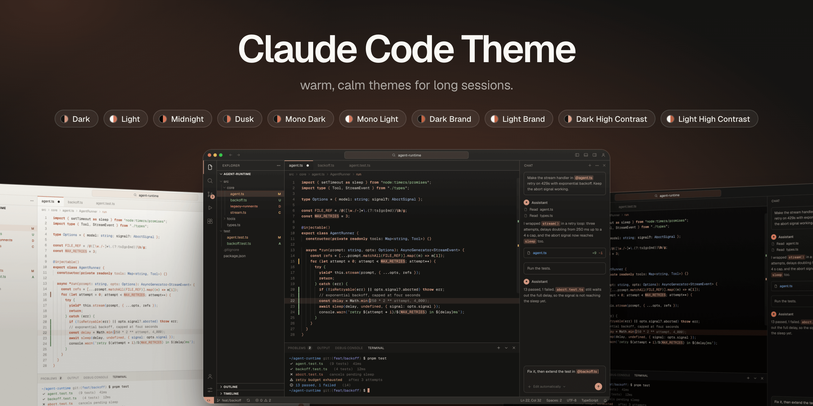</p>

## flavors

<table align="center">
  <tr>
    <td align="center">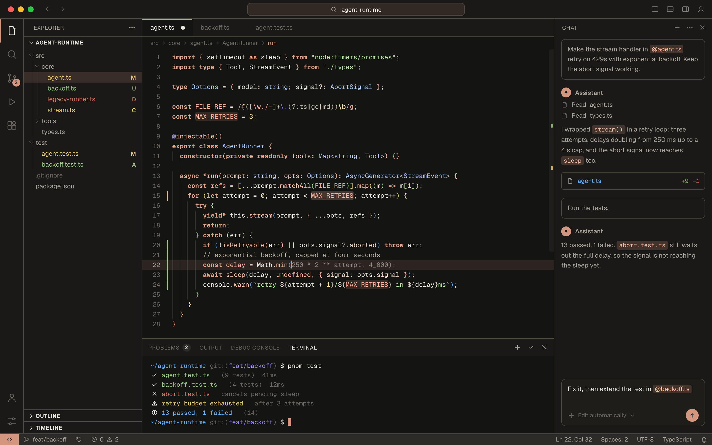<br><b>Dark</b> · the default. ink + clay</td>
    <td align="center">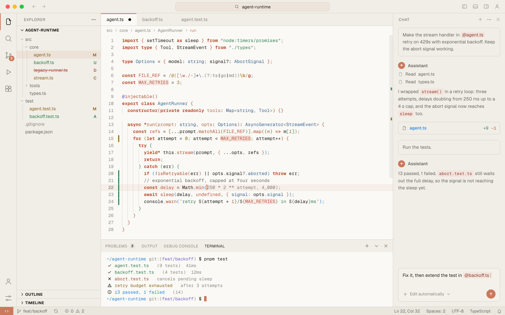<br><b>Light</b> · ivory paper</td>
  </tr>
  <tr>
    <td align="center">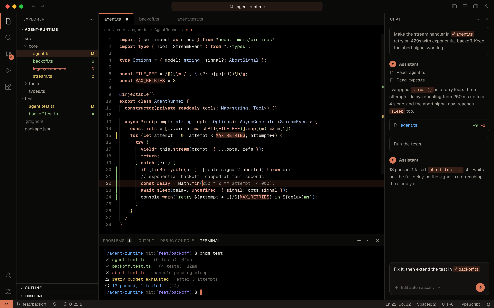<br><b>Midnight</b> · true black, for OLED</td>
    <td align="center">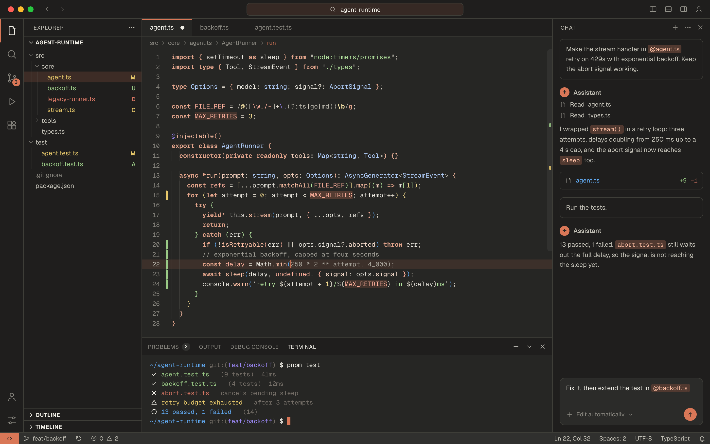<br><b>Dusk</b> · claude.ai after dark</td>
  </tr>
  <tr>
    <td align="center">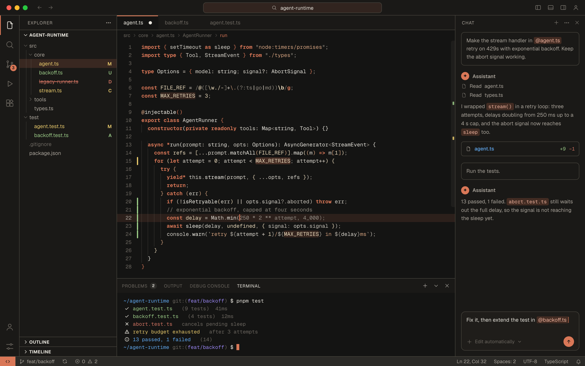<br><b>Mono Dark</b> · focus mode. less noise</td>
    <td align="center">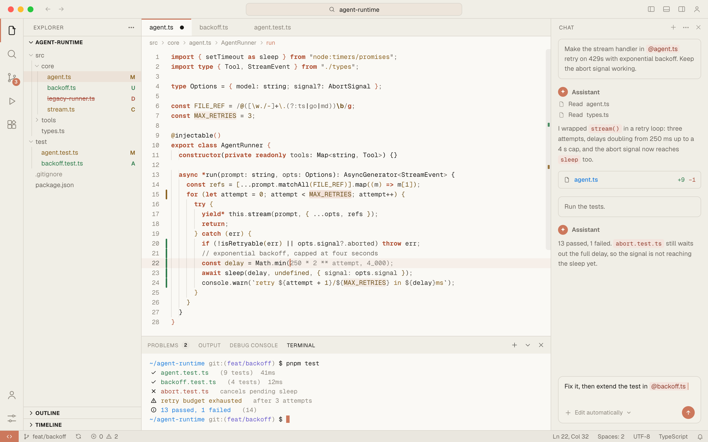<br><b>Mono Light</b> · focus mode, daylight</td>
  </tr>
  <tr>
    <td align="center">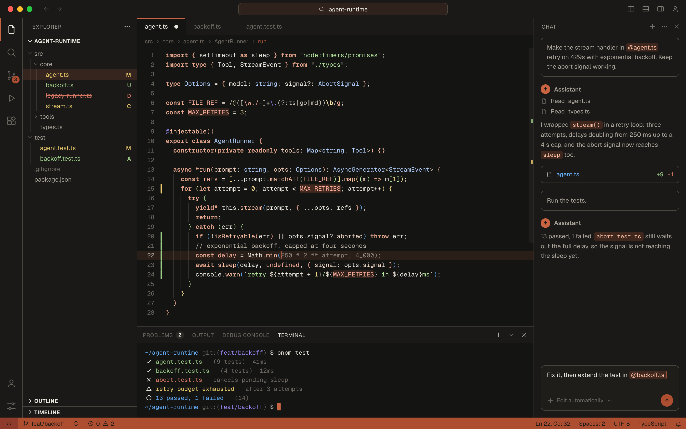<br><b>Dark Brand</b> · clay chrome</td>
    <td align="center">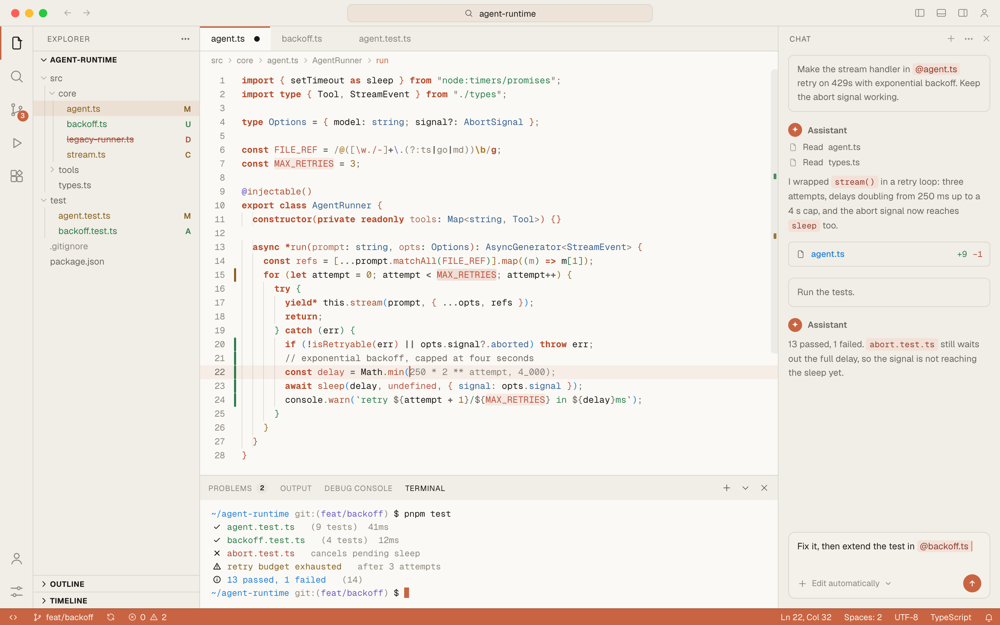<br><b>Light Brand</b> · clay chrome, light</td>
  </tr>
  <tr>
    <td align="center">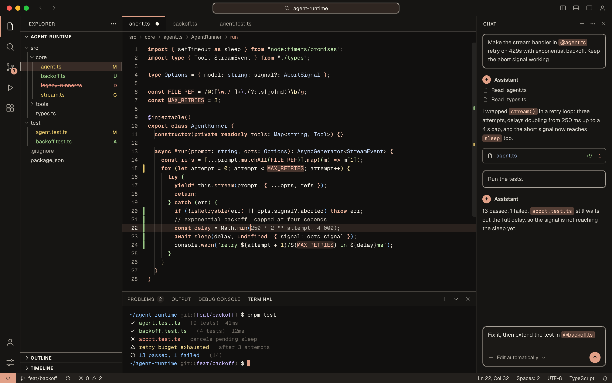<br><b>Dark High Contrast</b> · max legibility</td>
    <td align="center">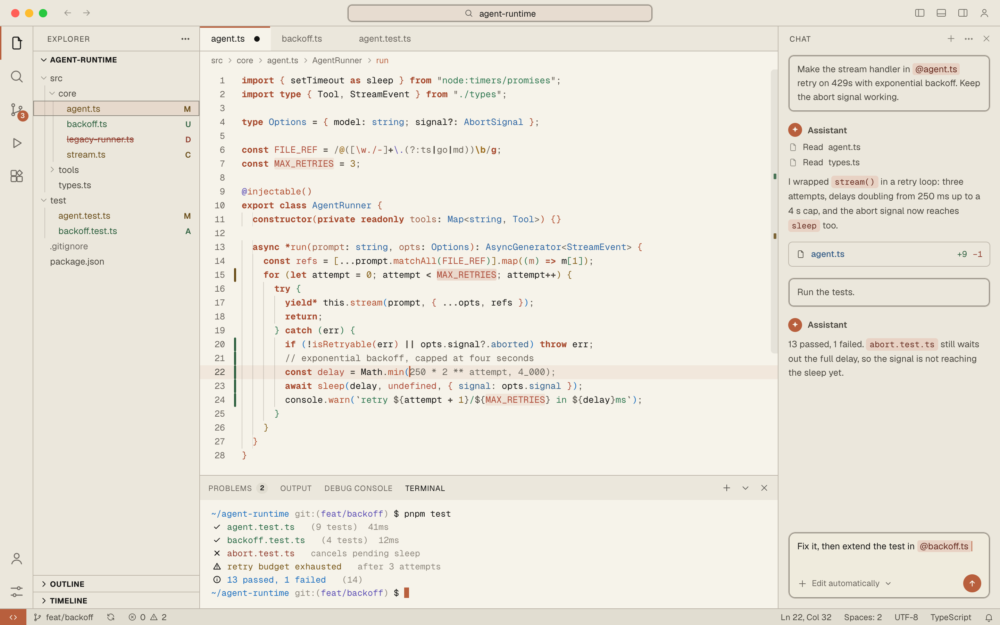<br><b>Light High Contrast</b> · max legibility</td>
  </tr>
</table>

<p align="center">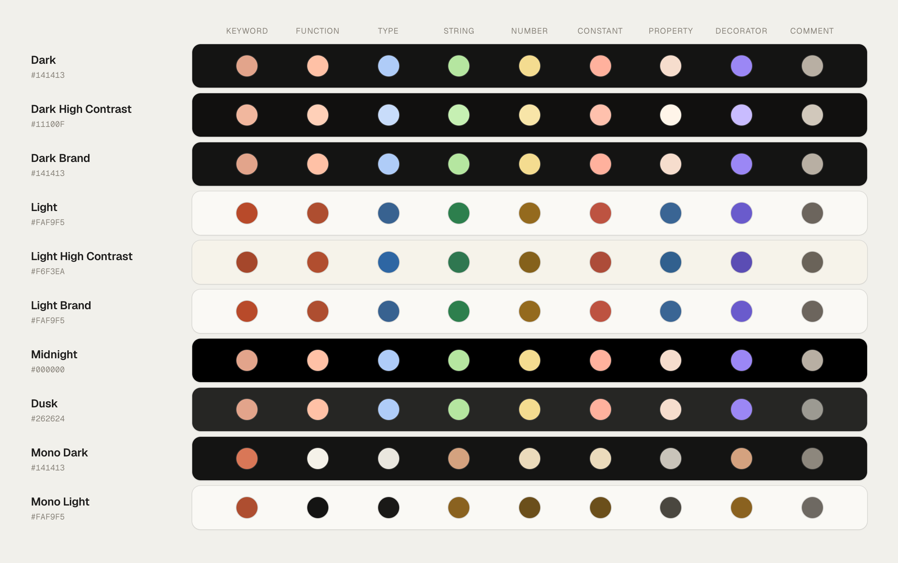</p>

## install

**VS Code** → `ext install ashwingopalsamy.claude-code-theme`

**Cursor · Windsurf · VSCodium** → search "Claude Code Theme" (via [Open VSX](https://open-vsx.org/extension/ashwingopalsamy/claude-code-theme))

then `⌘K ⌘T` (`Ctrl+K Ctrl+T`) → type **claude**.

## no bold?

every flavor ships a **(No Bold)** twin.

<p align="center">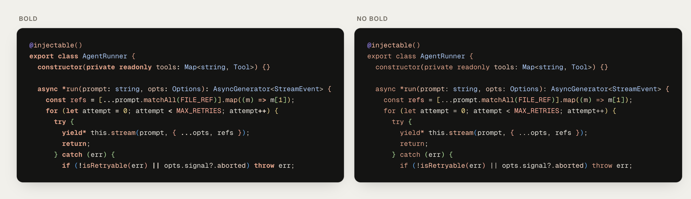</p>

## make it yours

```jsonc
{
  "workbench.colorTheme": "Claude Code Dark",
  "editor.fontFamily": "Geist Mono, JetBrains Mono, monospace",
  "editor.tokenColorCustomizations": {
    "[Claude Code Dark]": { "comments": { "fontStyle": "italic" } }
  }
}
```

<sub>not affiliated with Anthropic · [MIT](./LICENSE) · [changelog](./CHANGELOG.md) · [contributing](./CONTRIBUTING.md)</sub>
